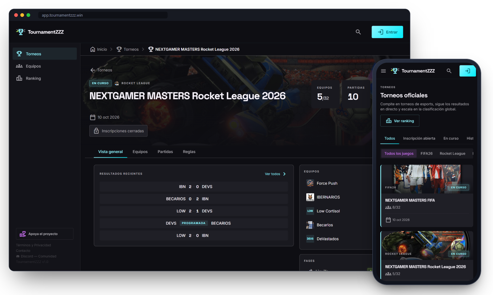
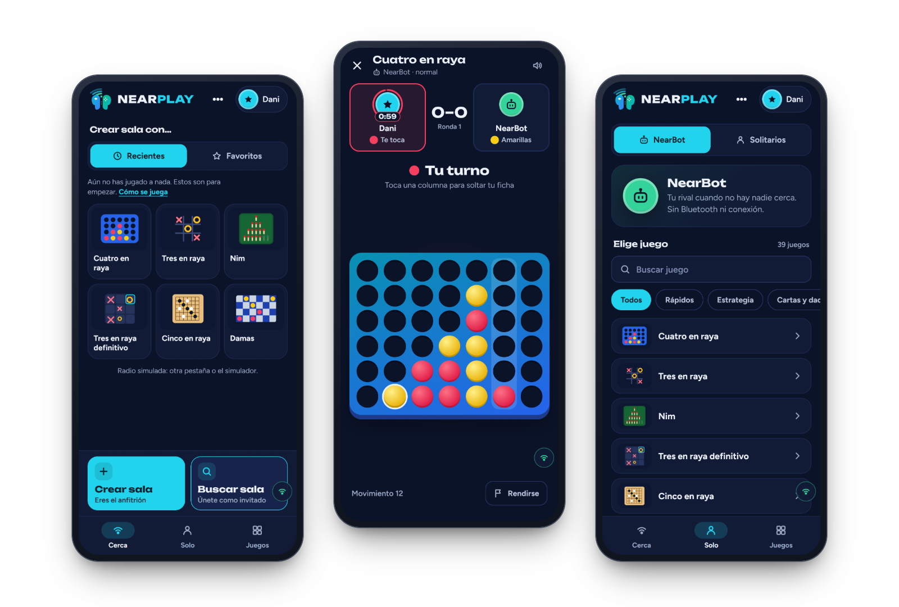
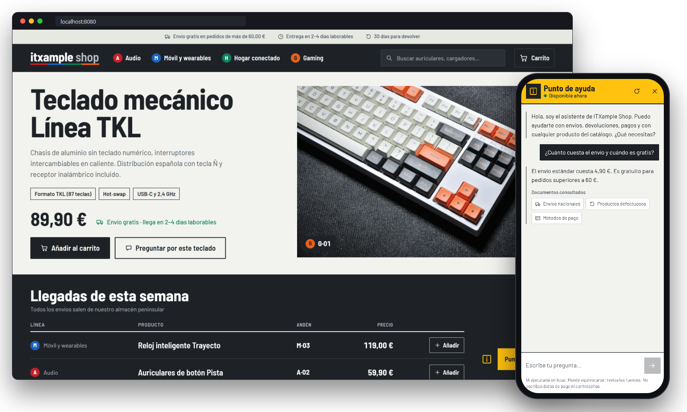

  

  

  
  
  
  

---

Hey, I'm **Dani** 👋 I'm a frontend architect from Spain, working remote.

I've spent **7+ years** making web apps. These days I mostly work on the parts nobody sees: the libraries, CLIs, SDKs and conventions that let a dozen teams ship without stepping on each other. When the day job is done, I build and run my own products, from the first Figma frame to the server they run on.

## 🏗️ By day: the platform

**Frontend Architect & Tech Lead @ Viewnext**, on a large public-sector platform in Spain.

- 🧱 **Built the frontend platform from scratch:** microfrontends with Module Federation, a monorepo of shared libraries and Web Components. **10+ apps** from several vendors run on it today.
- ⚡ **Cut new-app bootstrap from weeks to hours** with an in-house CLI (it has a plugin system), Angular Schematics and SDKs.
- 🔭 **Made observability the default.** I wrote a modular OpenTelemetry SDK, so every app on the platform gets traced the same way.
- 🚀 **Led the platform through Angular 16 → 17 → 19 → 21** and checked the impact on every consumer before each jump.
- 🤖 **Brought AI into the whole dev cycle,** from story refinement to code review. I build our own **MCP servers** and plug LLMs (including local ones) into the team's daily workflow.
- 🧑‍🤝‍🧑 **People lead for ~15 engineers.** I also mentor FP Dual students every year, because someone once did that for me.

## 🌙 By night: things I ship myself

### 🏆 [TournamentZZZ](https://tournamentzzz.win)

Esports tournament management for communities that have outgrown spreadsheets and Discord pings. It handles teams, brackets, live results, ELO rankings, roles, notifications and Discord integration. It's a PWA, so you can install it like a desktop app, and it works just as well on your phone.

I own all of it: the product, the design, the code and the self-hosted infrastructure.

  
  
  
  
  
  

### 📡 [NearPlay](https://nearplayapp.download)

Phones in the same room, one game, no internet. One person creates a room, everyone nearby joins over Bluetooth, and you play. There are **dozens of games**, from Connect Four and chess to parchís and Spanish card games like Chinchón and Brisca, plus **NearBot** for when nobody's around. You don't need an account, and the app collects zero user data.

It's published on Google Play. Yes, it's built with Angular.

  
  
  
  
  

### 🤖 [ITXample Shop](https://github.com/dani-b-g/chatbot_angular_rag): a support bot that runs on your machine

An open-source proof of concept: a customer-support chatbot for a made-up electronics store, with **no paid API and no keys**. Ask about shipping, returns or a product, and the NestJS API embeds your question, pulls the closest chunks from a set of Markdown docs (local RAG, cosine similarity) and **streams the answer** from a small local model over Server-Sent Events. Every reply lists the documents it was built from, so you can check it instead of trusting it.

`docker compose up` is all it takes. That one command starts Ollama, downloads the models, builds the index and serves the Angular store on `localhost:8080`, with optional NVIDIA GPU support. The repo is upfront about what's missing before production: auth, rate limiting, a vector DB and answer evaluation.

  
  
  
  
  
  
  

## 🤝 Open source I put time into

| Project | What I do there |
| --- | --- |
| [**IT Tools**](https://github.com/CorentinTh/it-tools) · 35k+ ★ | Contributor to the client-side dev toolbox where nothing leaves your browser. ([my fork](https://github.com/dani-b-g/it-tools)) |
| [**pa11y-dashboard**](https://github.com/pa11y/pa11y-dashboard) · 1k+ ★ | Contributor, and I maintain [**pa11y-dashboard-noMongo**](https://github.com/dani-b-g/pa11y-dashboard-noMongo), a fork that runs accessibility monitoring without MongoDB. |

## 🧰 Toolbox

  

  Plus the stuff without a logo: <b>Module Federation</b> · <b>Nx</b> · <b>Web Components / Lit</b> · <b>RxJS & Signals</b> · <b>OpenTelemetry</b> · <b>Playwright</b> · <b>WCAG</b> · <b>OpenShift</b> · <b>MCP</b> · <b>Ollama & local RAG</b> · <b>Claude Code</b>

## 🎧 Currently on repeat

  

  
<b>📊 Nerd stats</b> (click if you like charts)

   
  

    
  

  

    
    
  

---

  <b>Need someone who can design the architecture, ship the product and get the team behind it?</b> 
  <a href="https://www.linkedin.com/in/daniel-b-g/">Let's talk on LinkedIn →</a>

  

